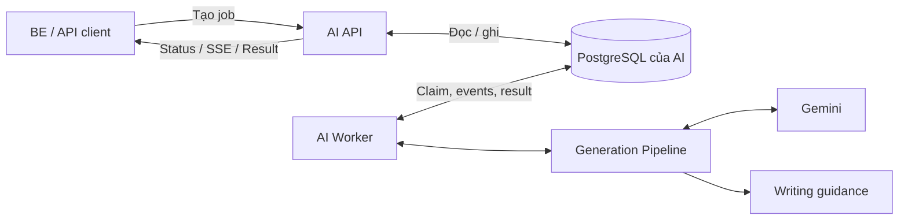

# Tổng quan project CV AI Agent

Tài liệu này giải thích kiến trúc hiện tại và cách đọc code. Project là một
service AI độc lập, nhận JD cùng thông tin ứng viên để tạo CV mới theo canonical
schema. Service tự quản lý job, tiến độ và kết quả trong PostgreSQL của AI.

Khi đọc code, hãy tách hai câu hỏi:

- **Job được vận hành như thế nào?** Xem API, Jobs và Worker.
- **Nội dung CV được tạo như thế nào?** Xem Pipeline, Core, LLM, Knowledge và Guard.

## 1. Mục tiêu, đầu vào và đầu ra

Mỗi generation xử lý một snapshot độc lập theo mô hình one-shot. Nếu thiếu dữ liệu
bắt buộc, service trả `needs_input`; bên gọi bổ sung thông tin rồi gửi một yêu cầu
mới. Không có endpoint hội thoại hoặc cập nhật turn trong job đang chạy.

### Đầu vào

| Trường | Ý nghĩa |
| --- | --- |
| `requestId` | Nhận diện yêu cầu, chống tạo job trùng |
| `jobDescription` | JD của vị trí ứng tuyển |
| `profile` | Thông tin cá nhân, kinh nghiệm, học vấn, dự án, kỹ năng, chứng chỉ, thành tích và ngôn ngữ |
| `options` | `language`, `industry`, `templateSlug` |
| `renderDefaults` | `design`, `locale`, `settings` được bên gọi cung cấp |

Các item lặp trong profile có client-stable ID để truy vết dữ kiện và tạo ID cho
CV. API job mới tự cấp ID generation; endpoint stream cũ vẫn nhận `generationId`
từ bên gọi để giữ contract hiện có.

### Đầu ra

| Trường | Ý nghĩa |
| --- | --- |
| `status` | `success`, `partial`, `needs_input` hoặc `failed` |
| `document` | Canonical document gồm `cv`, `design`, `locale`, `settings` |
| `cvYaml` | YAML được serialize từ cùng `document.cv`; không phải bản sao độc lập để chỉnh riêng |
| `report` | Evidence đã dùng, keyword JD còn thiếu và warnings |
| `gaps` | Các thông tin bắt buộc hoặc khuyến nghị còn thiếu |

`document` và `cvYaml` chỉ có khi generation tạo được CV hợp lệ. Trong các kết quả
không tạo được CV, chúng là `null`.

Contract nằm trong [generation schemas](../../src/schemas/generation.py) và
[job contracts](../../src/jobs/contracts.py), được công bố qua OpenAPI tại `/docs`.

## 2. Ba nguồn thông tin có vai trò khác nhau

| Nguồn | Vai trò |
| --- | --- |
| Candidate Profile | Nguồn facts cá nhân duy nhất |
| JD | Xác định yêu cầu vị trí và mức độ liên quan của thông tin |
| RAG | Hướng dẫn cách viết và trình bày CV |

Ví dụ:

```text
Profile: Đã xây API đăng nhập bằng NestJS và JWT.
JD: Yêu cầu kinh nghiệm backend và Kubernetes.
RAG: Diễn đạt rõ hành động, chức năng và công nghệ có bằng chứng.

Có thể viết: Phát triển API đăng nhập bằng NestJS, tích hợp xác thực JWT.
Không có căn cứ để thêm: Quản lý Kubernetes hoặc phục vụ 10.000 người dùng.
```

Evidence ghi lại thông tin ứng viên đã cung cấp. Nó không xác minh độc lập rằng
kinh nghiệm của người dùng là thật ngoài đời. Guard đối chiếu nội dung sinh ra với
nguồn dữ liệu này, không thực hiện background check.

## 3. Kiến trúc vận hành



### API

FastAPI nhận request, kiểm tra cấu trúc, chuẩn hóa biên chuỗi, chống request trùng
và lưu job trước khi trả `202`. API cũng đọc trạng thái, kết quả và phát SSE từ
events đã lưu. API không tự chạy worker ngầm.

Trong [API module](../../src/api/routes.py):

- [server.py](../../src/api/server.py): khởi tạo app, middleware, database lifecycle và health.
- [auth.py](../../src/api/auth.py): service Bearer authentication bằng `AI_SECRET_KEY`.
- [routes.py](../../src/api/routes.py): HTTP endpoints, request/response và subscription SSE.
- [service.py](../../src/api/service.py): adapter cho endpoint stream cũ.

Hiện một backend sử dụng service. `AI_SECRET_KEY` để trống vẫn giữ hành vi bỏ qua
authentication của local development. Quyền user và quyền sử dụng CV thuộc bên
tích hợp, không phải logic generation.

### PostgreSQL và Jobs

Database AI là nguồn trạng thái generation. Hai bảng chính:

- `ai_generation_jobs`: input snapshot/hash, trạng thái, attempt, lease, deadline,
  kết quả, lỗi và timestamps.
- `ai_generation_events`: sequence, attempt, loại event và payload của từng job.

[repository.py](../../src/jobs/repository.py) thực hiện các thao tác database có
transaction; [jobs/service.py](../../src/jobs/service.py) tạo status view và đọc
events để phát stream. Đây là phần quản lý job thực tế, khác với adapter ở
`api/service.py`.

### Worker

[worker.py](../../src/worker.py) là process riêng. Nó claim job, gia hạn lease,
gọi pipeline, kiểm tra kết quả rồi lưu terminal state/result/event trong cùng
transaction.

Worker đọc job từ PostgreSQL, không cần Redis hoặc message broker trong phiên bản
hiện tại. Database Render không được dùng cho job storage của AI.

“Stateful” ở đây là trạng thái job được lưu bền vững. State không phải bộ nhớ
hội thoại hoặc cơ chế tự học từ CV người dùng.

## 4. Luồng tạo một CV

```text
POST request
  -> Validate cấu trúc và normalize input
  -> Deduplicate requestId, lưu snapshot, tạo QUEUED job
  -> Worker claim job, chuyển RUNNING
  -> Gaps -> Evidence -> JD Analysis -> RAG -> Plan
  -> Generate sections -> Guard -> Canonical builder -> Validate -> YAML
  -> Lưu kết quả và terminal event
  -> Bên gọi đọc status, SSE hoặc result
```

Các bước xử lý CV được điều phối trong
[orchestrator.py](../../src/pipeline/generation/orchestrator.py):

| Bước | Công việc và component chính |
| --- | --- |
| Gap detection | [gaps.py](../../src/pipeline/generation/gaps.py) kiểm tra dữ liệu tối thiểu |
| Evidence | [evidence.py](../../src/pipeline/generation/evidence.py) tách facts từ Candidate Profile thành evidence có ID và source path |
| JD analysis | [JDAnalyzer](../../src/core/jd_analyzer.py) gọi Gemini để trích xuất role, seniority, skills, responsibilities và keywords |
| RAG | Retriever lấy guidance theo section, ngôn ngữ, ngành và query |
| Plan | [plan.py](../../src/pipeline/generation/plan.py) lập danh sách sections và ánh xạ evidence theo nguồn |
| Generate và Guard | [sections.py](../../src/pipeline/generation/sections.py) gọi writers, đối chiếu evidence và phát section drafts |
| Canonical build | [builder.py](../../src/pipeline/generation/builder.py) ghép document, tạo stable IDs, lấy style từ request |
| Validate và serialize | Kiểm tra canonical schema rồi tạo YAML từ `document.cv` |

Orchestrator điều phối; việc phân tích và viết nằm trong các component chuyên
trách. Plan hiện được tạo bằng deterministic code theo profile.

### Dữ liệu tối thiểu

JD, name, email và target position phải có. Đồng thời cần ít nhất một trong các
nguồn sau:

- Experience có facts không rỗng.
- Project có facts không rỗng.
- Education có institution và degree.

Thiếu dữ liệu bắt buộc trả `needs_input` trước khi gọi writers. Phone, location,
metrics và dates là gaps khuyến nghị; không bắt buộc bổ sung để tiếp tục tạo CV.
Các field có kiểu dữ liệu sai bị API từ chối bằng `422` trước khi tạo job.

### Phần nào dùng LLM, phần nào dùng code?

| Thành phần | Cách xử lý |
| --- | --- |
| Phân tích JD | Gemini |
| Summary | Gemini sinh nội dung có `evidenceIds` |
| Experience | Gemini đề xuất rewrite; guard kiểm tra từng proposal |
| Projects | Gemini viết highlights khi có facts; guard đối chiếu evidence |
| Contact, Education, Certifications, Achievements, Languages | Code copy/map thông tin profile |
| Skills | Code sắp xếp danh sách kỹ năng user đã cung cấp theo JD |
| IDs, style, cấu trúc document, validation và YAML | Deterministic code |

Deterministic nghĩa là xử lý theo quy tắc code với cùng input, chẳng hạn kiểm tra
field, tạo UUID5 hay ghép document. Nó không đồng nghĩa với một provider giả.
Runtime hiện chỉ hỗ trợ Gemini; không có mock/offline generation mode.

## 5. RAG, evidence và guard

[Knowledge module](../../src/knowledge/static_retriever.py) hiện dùng static corpus
và lexical scoring. Retriever lọc theo section, industry, language rồi lấy các
guidance phù hợp, mặc định top 5 cho mỗi section được truy vấn.

Ở thời điểm tài liệu này được thêm, [corpus](../../src/knowledge/corpus.py) có 24
đoạn, gồm 12 tiếng Việt và 12 tiếng Anh; tất cả thuộc Experience. Summary và
Projects đã có bước retrieval nhưng chưa có corpus riêng. Chưa có embeddings hoặc
vector database trong implementation hiện tại.

Writers gửi evidence ID cùng nội dung sinh ra. [DeterministicGuard](../../src/guard/deterministic_guard.py)
kiểm tra các quy tắc như evidence hợp lệ, phạm vi entry, số liệu và một số dạng
claim không được hỗ trợ. Guard dùng quy tắc và text matching, không bảo đảm phát
hiện mọi cách diễn đạt sai về ngữ nghĩa.

Nếu guard từ chối nội dung, hệ thống có thể giữ facts gốc và trả `partial` cùng
warnings. RAG là guidance tùy chọn; retrieval lỗi có thể tiếp tục qua NullRetriever.
Provider lỗi thì job thất bại với diagnostics, không chuyển sang heuristic CV.

Canonical validator kiểm tra cấu trúc document. Guard kiểm tra một số điều kiện
grounding của nội dung. Hai bước này giải quyết hai loại kiểm tra khác nhau.

## 6. Job state, SSE và phục hồi

```text
QUEUED -> RUNNING -> NEEDS_INPUT
                 -> COMPLETED
                 -> FAILED
```

| Trạng thái | Ý nghĩa |
| --- | --- |
| `QUEUED` | Job đã được lưu, đang chờ worker |
| `RUNNING` | Một worker đang sở hữu lease và thực thi |
| `NEEDS_INPUT` | Thiếu thông tin bắt buộc; bổ sung rồi tạo yêu cầu mới |
| `COMPLETED` | CV hợp lệ đã được lưu trong AI; result có thể là `success` hoặc `partial` |
| `FAILED` | Lỗi generation/provider, hết recovery budget hoặc quá deadline |

Worker dùng lease và heartbeat để xác nhận quyền xử lý. Khi worker chết, lượt xử
lý có thể được nhận lại sau khi lease hết hạn. Lease token chặn worker cũ ghi đè
event/kết quả sau khi mất quyền.

Phục hồi chạy lại toàn pipeline từ snapshot với cùng generation/source IDs;
không tiếp tục từ checkpoint của từng section. IDs giữ ổn định nhưng lời văn của
model có thể thay đổi và model có thể được gọi lại.

SSE đọc events đã commit. Đóng subscriber không hủy job. Client dùng
`Last-Event-ID` để nhận tiếp; một event có thể được replay nên bên gọi cần xử lý
trùng an toàn. Mỗi job chỉ có một terminal event được lưu:

- `needs_input`: dữ liệu chưa đủ.
- `done`: CV đã validate và lưu tại AI.
- `error`: generation thất bại.

Progress message luôn English; gap messages theo `vi` hoặc `en`. `partial_update`
là draft tạm thời; document cuối là kết quả có thẩm quyền.

Các giá trị mặc định trong [config.py](../../src/config.py):

| Cấu hình | Mặc định |
| --- | --- |
| Poll worker | 1 giây |
| Concurrency | 2 job trên mỗi worker |
| Deadline | 120 giây, gồm thời gian chờ queue |
| Lease / heartbeat | 30 giây / 5 giây |
| Số attempts tối đa | 2 |
| Retention | 24 giờ sau khi job kết thúc |

Deadline có thể được chuyển thành `FAILED` khi API đọc status/SSE/result, kể cả
khi worker đang tắt. Worker thực hiện recovery và cleanup vật lý. Kết quả quá
retention bị API ẩn; cleanup xóa cùng input và events.

## 7. API và ranh giới với ứng dụng web

| API | Mục đích |
| --- | --- |
| `POST /v1/ai/generations` | Tạo job hoặc trả job đã có với cùng normalized input và requestId |
| `GET /v1/ai/generations/{id}` | Đọc status, timestamps, attempt, gaps và lỗi |
| `GET /v1/ai/generations/{id}/events` | Theo dõi hoặc replay SSE |
| `GET /v1/ai/generations/{id}/result` | Lấy kết quả terminal; trả `409` nếu còn đang xử lý |
| `POST /v1/ai/generate/stream` | Adapter giữ contract stream cũ, dùng chung durable job store |

Cùng requestId nhưng nội dung khác trả `409`. Sau khi kết thúc, retry hoặc sửa
input dùng requestId mới. Với endpoint legacy, dùng generationId mới cho yêu cầu
mới. Idempotency chỉ được bảo đảm trong thời gian dữ liệu còn được lưu.

AI `done` không có `cvId`: nó xác nhận CV đã lưu ở AI. BE chịu trách nhiệm lưu CV
vào ứng dụng web và cấp `cvId` của ứng dụng. Một lỗi lưu CV ở BE có thể được xử lý
bằng cách lấy lại AI result, không cần chạy model lại.

`/health/live` kiểm tra API process; `/health/ready` kiểm tra PostgreSQL và schema
migration. Readiness hiện không xác nhận worker đang chạy hoặc Gemini hoạt động.

## 8. Debug, test và tiện ích

Khi job thất bại, đọc `error` qua status API: `code`, `stage`, `schema`,
`errorType`, `location` và có thể có `sourceId`. Tra worker log bằng jobId hoặc
requestId. Ví dụ `LLM_AUTHENTICATION_ERROR` ở `summary` cho biết lời gọi model của
Summary gặp lỗi xác thực; `GENERATION_TIMEOUT` là deadline của toàn job.

Worker yêu cầu API key và model khi khởi động. API và CLI không yêu cầu credentials
của model. Xem cách chạy, migration và log trong [README](../../README.md).

Test doubles chỉ nằm trong `tests/`, được inject rõ ràng và không được đóng gói
vào production. Bộ test gồm pipeline, provider, guard, API, database và các case
kill/restart process. Tests PostgreSQL dùng database test riêng, không dùng Render.

[CLI](../../src/cli.py) có hai tiện ích parse/validate source CV từ Markdown/YAML.
CLI dùng `CvInput` cho file nguồn, tách với canonical document validation của
generation. Nó không tạo AI job, không gọi Gemini và không cần PostgreSQL.

## 9. Thứ tự đọc code đề xuất

1. [API routes](../../src/api/routes.py): bên tích hợp gọi service bằng cách nào.
2. [Worker](../../src/worker.py): job được thực thi và kết thúc như thế nào.
3. [Generation orchestrator](../../src/pipeline/generation/orchestrator.py): toàn bộ luồng tạo CV.
4. [Sections](../../src/pipeline/generation/sections.py): writers phối hợp với guard.
5. [Canonical builder](../../src/pipeline/generation/builder.py): nội dung trở thành document ra sao.
6. [Job repository](../../src/jobs/repository.py): transaction, idempotency, lease, deadline và retention.

Sau phần tổng quan, tiếp tục theo [learning path](README.md) để đọc chi tiết từng
component, hoặc xem [glossary](glossary.md) khi gặp thuật ngữ mới.
