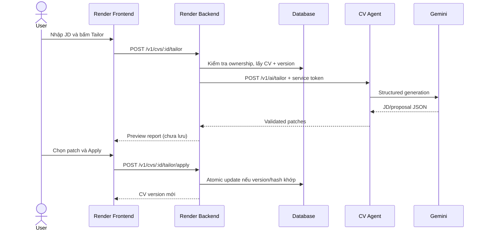

# 01 — Kiến trúc hệ thống

## Bạn sẽ học được gì?

Sau chương này, bạn có thể mô tả trách nhiệm của từng service, lý do browser không gọi trực tiếp Agent và sự khác nhau giữa sync API, SSE và background job.

## Khái niệm nền tảng

**Monolith** đặt nhiều chức năng trong một ứng dụng/deployment. Ưu điểm là đơn giản lúc đầu; nhược điểm là phần AI có dependency, tài nguyên và vòng đời khác backend nghiệp vụ.

**Microservice** tách một năng lực thành service có API riêng. CV Agent là microservice hợp lý vì:

- Python có hệ sinh thái AI tốt;
- model call có latency và failure mode riêng;
- có thể scale Agent độc lập;
- Render Backend vẫn giữ quyền sở hữu dữ liệu.

**Stateless service** không dựa vào memory của request trước. Mỗi request gửi đủ CV, JD và options. Nhờ vậy nhiều instance Agent có thể xử lý thay nhau. Stateless không có nghĩa là toàn hệ thống không lưu trạng thái: Render vẫn lưu CV và version trong database.

**Service-to-service authentication** xác minh Backend được phép gọi Agent. Browser dùng session/JWT để gọi Render Backend; Backend dùng một bearer secret khác để gọi Agent. Không chuyển cookie người dùng sang Agent.

## Ví dụ ngoài project

Một ứng dụng đặt đồ ăn có frontend, order backend và payment service. Frontend không giữ khóa bí mật của payment provider; order backend xác thực user rồi mới gọi payment service. Render và CV Agent có ranh giới tương tự.

## Áp dụng vào CV Agent

Ranh giới trách nhiệm:

| Thành phần | Được làm | Không được làm |
|---|---|---|
| Frontend | Nhập JD, hiển thị diff, ghi nhận lựa chọn | Giữ service key, tự xác nhận ownership |
| Render Backend | Auth, đọc/lưu CV, OCC, audit | Tin mù quáng output AI |
| CV Agent | Phân tích, retrieve, đề xuất, guard | Tự ghi database CV |
| Gemini | Sinh output theo schema | Quyết định dữ kiện nào là sự thật |
| Retriever | Chọn hướng dẫn liên quan | Cung cấp sự thật cá nhân của ứng viên |

## Code/module hiện tại

- Agent HTTP: [`src/api/routes.py`](../../src/api/routes.py), [`src/api/service.py`](../../src/api/service.py).
- Agent auth: [`src/api/auth.py`](../../src/api/auth.py).
- Render Backend: [`CvController`](../../../Render/MODULE_BE/src/cv/cv.controller.ts) và [`CvService`](../../../Render/MODULE_BE/src/cv/cv.service.ts).
- Render Frontend: [`AiAssistant`](../../../Render/MODULE_FE/src/features/assistant/AiAssistant.tsx) và [`useAiSse`](../../../Render/MODULE_FE/src/features/assistant/useAiSse.ts).

Hiện Backend đã có endpoint preview/apply. Frontend chưa có review flow hoàn chỉnh. Hook SSE hiện gọi AI URL trực tiếp; luồng tailor production phải đi qua Backend.

## Sync, SSE và background job

| Kiểu | Khi dùng | Trade-off |
|---|---|---|
| Sync HTTP | MVP, thời gian dưới timeout gateway | Dễ làm; user chờ một response |
| SSE | Cần hiển thị tiến độ một chiều | Reconnect/cancel phức tạp hơn |
| Background job | Tác vụ lâu, retry, queue | Cần job store, worker và polling/event |

MVP có thể dùng sync cho preview. SSE chỉ là kênh truyền tiến độ, không thay đổi quy tắc quyền hạn hoặc dữ liệu.

## Lỗi thường gặp

- Đặt Gemini key trong frontend: key sẽ bị lộ.
- Cho Agent ghi database: phá ranh giới ownership và audit.
- Coi CORS là authentication: CORS chỉ là chính sách browser.
- Giữ trạng thái review trong memory Agent: mất khi restart/scale.
- Retry apply khi nhận `409`: có thể ghi trên dữ liệu đã thay đổi.

## Bài tập thực hành

1. Viết lại sequence trên bằng lời, ghi rõ dữ liệu ở mỗi mũi tên.
2. Đánh dấu nơi cần user token và nơi cần service token.
3. Giả sử Gemini mất 40 giây: chọn sync, SSE hay job và giải thích.

## Checklist hoàn thành

- [ ] Tôi giải thích được vì sao Render Backend là data owner.
- [ ] Tôi biết stateless khác “không có database” thế nào.
- [ ] Tôi biết browser không được có Agent service key.
- [ ] Tôi phân biệt sync, SSE và background job.

## Câu hỏi tự kiểm tra

1. Nếu Agent trả patch hợp lệ, ai có quyền quyết định lưu?
2. Nếu user A đoán được CV ID của user B, lớp nào phải chặn?
3. SSE có làm model chạy nhanh hơn không?

