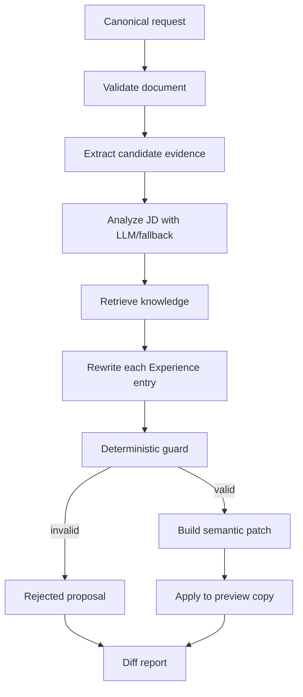

# 02 — Agent hoạt động như thế nào

## Bạn sẽ học được gì?

Bạn sẽ hiểu “Agent” trong project này thực chất là workflow được điều phối, phân biệt bước chắc chắn với bước phụ thuộc LLM và theo dấu một Experience bullet từ input tới proposal.

## Khái niệm nền tảng

**Agent** là hệ thống dùng model để quan sát input, tạo quyết định/output và gọi các công cụ theo một quy trình. Agent không bắt buộc phải tự lập kế hoạch vô hạn.

Project dùng **fixed workflow agent**: thứ tự các bước được code quy định. Nó phù hợp với CV vì an toàn, dễ test và dễ audit hơn autonomous agent.

**Orchestrator** nối các component, truyền dữ liệu và xử lý lỗi. Orchestrator không nên chứa toàn bộ prompt, retrieval algorithm hoặc guard logic.

**Deterministic step** cho cùng input sẽ cho cùng output: schema validation, hash, patch apply, regex guard. **Probabilistic step** có thể thay đổi: Gemini phân tích JD hoặc viết lại bullet.

**Dependency injection** truyền provider/retriever từ bên ngoài. Test có thể dùng `MockProvider`; production dùng `GeminiProvider`, không cần đổi pipeline.

## Ví dụ ngoài project

Quy trình kiểm tra sân bay gồm các bước cố định: kiểm tra vé → hành lý → an ninh → lên máy bay. Nhân viên có thể đánh giá thủ công ở một bước, nhưng thứ tự và cổng kiểm tra không tự thay đổi. Agent workflow cũng như vậy.

## Pipeline hiện tại



Pipeline chính nằm tại [`src/pipeline/agent_orchestrator.py`](../../src/pipeline/agent_orchestrator.py).

## Bảng input/output từng bước

| Bước | Input | Output | Failure policy | Test/module |
|---|---|---|---|---|
| Validate | document dict | valid/errors | Dừng, trả `failed` | `canonical_validator.py` |
| Evidence | canonical CV | `EvidenceStore` | Dữ liệu thiếu → ít evidence | `test_evidence_and_jd.py` |
| JD analysis | JD text | role, seniority, skills | LLM lỗi → rule fallback | `jd_analyzer.py` |
| Retrieve | JD profile + filters | knowledge chunks | Empty → vẫn viết không-RAG | `test_knowledge_eval.py` |
| Rewrite | entry + evidence + knowledge | typed proposals | Entry lỗi → giữ nguyên entry | `experience_writer.py` |
| Guard | proposal + evidence | valid/reasons/checks | Reject proposal | `test_writer_and_guards.py` |
| Patch | validated proposal | `SemanticPatch` | Không có patch nếu reject | `canonical_dto.py` |
| Preview apply | document copy + patches | preview/errors | Lỗi → giữ document gốc | `test_patch_applier.py` |

## Theo dấu một bullet

Input:

```text
Built APIs with FastAPI and PostgreSQL for the payment service.
```

1. Evidence extractor tạo ID ổn định cho nguyên văn bullet và các technology `fastapi`, `postgresql`.
2. JD Analyzer tìm thấy yêu cầu “Backend Engineer, REST, PostgreSQL”.
3. Retriever trả quy tắc viết backend và action verbs.
4. Writer đề xuất: “Developed payment APIs with FastAPI and PostgreSQL.”
5. Guard xác minh mọi technology và evidence ID đều có trong CV.
6. Pipeline tạo patch với vị trí stable ID và hash của câu cũ.
7. Render chỉ hiển thị diff; chưa lưu cho đến khi user chọn Apply.

Nếu Writer thêm “reduced latency by 70%” nhưng CV không có `70%`, guard phải reject.

## Vì sao chưa cần multi-agent?

Nhiều agent làm tăng số model call, latency, chi phí và khả năng các agent bất đồng. MVP chỉ có một mục tiêu hẹp và pipeline rõ ràng. Chỉ cân nhắc multi-agent khi có nhiệm vụ độc lập thật sự, benchmark chứng minh chất lượng tăng và có cơ chế hợp nhất kết quả.

## Lỗi thường gặp

- Gọi mọi class là agent, làm mờ trách nhiệm.
- Cho LLM tự quyết định patch path.
- Catch mọi exception rồi coi là success.
- Dùng fallback nhưng không báo degraded status.
- Dùng knowledge chunk làm bằng chứng ứng viên.
- Áp dụng proposal trước khi guard.

## Bài tập thực hành

1. Chọn một bullet fixture và ghi lại dữ liệu sau từng bước pipeline.
2. Phân loại từng bước là deterministic hay probabilistic.
3. Tạo bảng cho ba lỗi: Gemini timeout, schema CV sai, retrieval rỗng. Quyết định fallback hay dừng.

Lệnh đọc test liên quan:

```powershell
python -m pytest -q tests/test_evidence_and_jd.py tests/test_writer_and_guards.py
```

## Checklist hoàn thành

- [ ] Tôi giải thích được orchestrator không phải LLM.
- [ ] Tôi theo dấu được evidence ID tới patch.
- [ ] Tôi biết lỗi nào được fallback và lỗi nào phải dừng.
- [ ] Tôi biết vì sao fixed workflow phù hợp MVP.

## Câu hỏi tự kiểm tra

1. Retrieval rỗng có bắt buộc làm request thất bại không?
2. Vì sao patch apply phải là deterministic?
3. Dependency injection giúp test nhanh hơn như thế nào?

