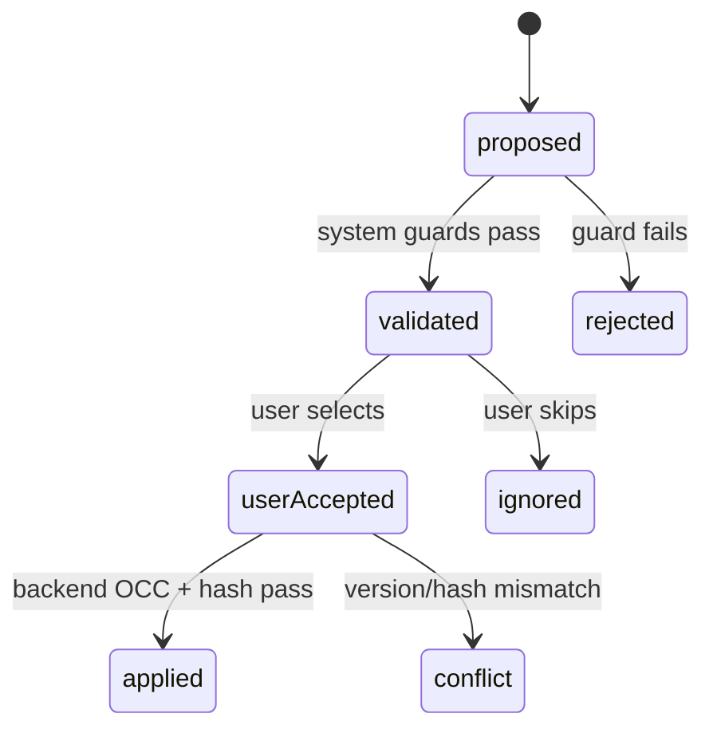

# 03 — Contract, evidence và semantic patch

## Bạn sẽ học được gì?

Bạn sẽ hiểu cách ba service thống nhất dữ liệu, tại sao output AI không được ghi đè cả CV và cách `baseVersion` kết hợp `beforeHash` ngăn mất thay đổi.

## Khái niệm nền tảng

**API contract** mô tả request/response mà các bên cam kết. **Schema** là biểu diễn máy có thể kiểm tra của contract. Project dùng:

- Zod/TypeScript cho Render;
- JSON Schema để trao đổi giữa ngôn ngữ;
- Pydantic cho Python runtime.

**Single source of truth** nghĩa là chỉ một nơi được coi là chuẩn. Mục tiêu là `packages/cv-contracts` của Render; schema Python được generate/sync từ đó, không chỉnh hai bản độc lập.

**Canonical document** là hình dạng CV chuẩn mà mọi module cùng hiểu. **Stable ID** xác định section/entry qua thời gian, đáng tin hơn array index khi user sắp xếp lại giao diện.

## Evidence và grounding

**Evidence** là dữ kiện lấy trực tiếp từ CV ứng viên: company, position, date, bullet, metric, technology. **Grounding** là ràng buộc câu AI viết với các evidence ID có thật.

Knowledge chunk không phải candidate evidence:

| Candidate evidence | Knowledge chunk |
|---|---|
| “Ứng viên dùng FastAPI” | “Bullet backend nên bắt đầu bằng action verb” |
| Có thể hỗ trợ factual claim | Chỉ hướng dẫn cách trình bày |
| Thuộc một CV cụ thể | Dùng chung cho nhiều CV |

Extractor nằm tại [`src/core/evidence_extractor.py`](../../src/core/evidence_extractor.py).

## Semantic patch

Thay vì trả toàn bộ CV mới, Agent trả thay đổi nhỏ có địa chỉ rõ ràng:

```json
{
  "op": "replace",
  "sectionId": "sec-experience",
  "entryId": "ent-exp-1",
  "field": "highlights",
  "index": 0,
  "beforeHash": "sha256-of-original-bullet",
  "value": "Developed payment APIs with FastAPI and PostgreSQL.",
  "evidenceIds": ["ev-hig-example"],
  "knowledgeChunkIds": ["it-rule-backend-microservices-en"]
}
```

Lợi ích:

- Review từng thay đổi.
- Không chạm design hoặc section khác.
- Có audit trail và citation.
- Có thể phát hiện CV đã đổi sau khi proposal được tạo.

DTO hiện tại ở [`src/schemas/canonical_dto.py`](../../src/schemas/canonical_dto.py), logic apply ở [`src/schemas/patch_applier.py`](../../src/schemas/patch_applier.py).

## Hash, OCC, idempotency và atomicity

`beforeHash = SHA256(original.trim())`. Khi apply, Backend tính hash bullet hiện tại. Không khớp nghĩa là nội dung đã đổi; trả `409 Conflict` thay vì ghi đè.

**Optimistic Concurrency Control (OCC)** giả định xung đột ít xảy ra. Request mang `baseVersion`; update chỉ thành công nếu database vẫn ở version đó.

Hai lớp bảo vệ:

```text
baseVersion: bảo vệ toàn CV
beforeHash: bảo vệ đúng bullet
```

**Atomicity**: hoặc tất cả patch hợp lệ được lưu cùng nhau, hoặc không patch nào được lưu. **Idempotency**: gửi lại cùng thao tác không tạo hậu quả lặp ngoài ý muốn. Apply hiện dựa vào OCC để request lặp bị conflict; production có thể bổ sung idempotency key nếu client retry tự động.

## Vòng đời trạng thái



Không gọi proposal là `accepted` trước khi user chọn. “Qua guard” và “được user chấp nhận” là hai quyết định khác nhau.

## Ví dụ conflict

1. Tab A và Tab B cùng mở CV version 5.
2. Tab A apply và database thành version 6.
3. Tab B gửi patch với `baseVersion=5`.
4. Backend trả `409`; Tab B reload rồi tạo proposal mới.

Không tự thay `baseVersion` thành 6 và retry: patch được tạo từ dữ liệu cũ.

## Lỗi thường gặp

- Dùng index section thay stable ID.
- Cho model tự sinh `beforeHash` thay vì code deterministic.
- Apply từng patch bằng nhiều transaction.
- Chỉ validate trước apply, không validate document kết quả.
- Cho phép patch company/date trong MVP.
- Nhầm knowledge citation với evidence grounding.

## Bài tập thực hành

Tính hash trong PowerShell:

```powershell
$text = "Built APIs with FastAPI".Trim()
$bytes = [Text.Encoding]::UTF8.GetBytes($text)
$hash = [Security.Cryptography.SHA256]::HashData($bytes)
[Convert]::ToHexString($hash).ToLower()
```

Sau đó:

1. Sửa bullet một ký tự và tính lại hash.
2. Tạo patch trỏ vào field `company`; dự đoán kết quả.
3. Mô phỏng hai request có cùng `baseVersion`.

## Checklist hoàn thành

- [ ] Tôi phân biệt contract, schema và DTO.
- [ ] Tôi biết candidate evidence khác knowledge chunk.
- [ ] Tôi giải thích được stable ID, version và hash.
- [ ] Tôi biết atomic apply bảo vệ dữ liệu thế nào.

## Câu hỏi tự kiểm tra

1. Vì sao `beforeHash` không thay thế hoàn toàn `baseVersion`?
2. Patch qua guard đã phải là `userAccepted` chưa?
3. Nếu apply ba patch và patch thứ ba sai, nên lưu hai patch đầu không?

