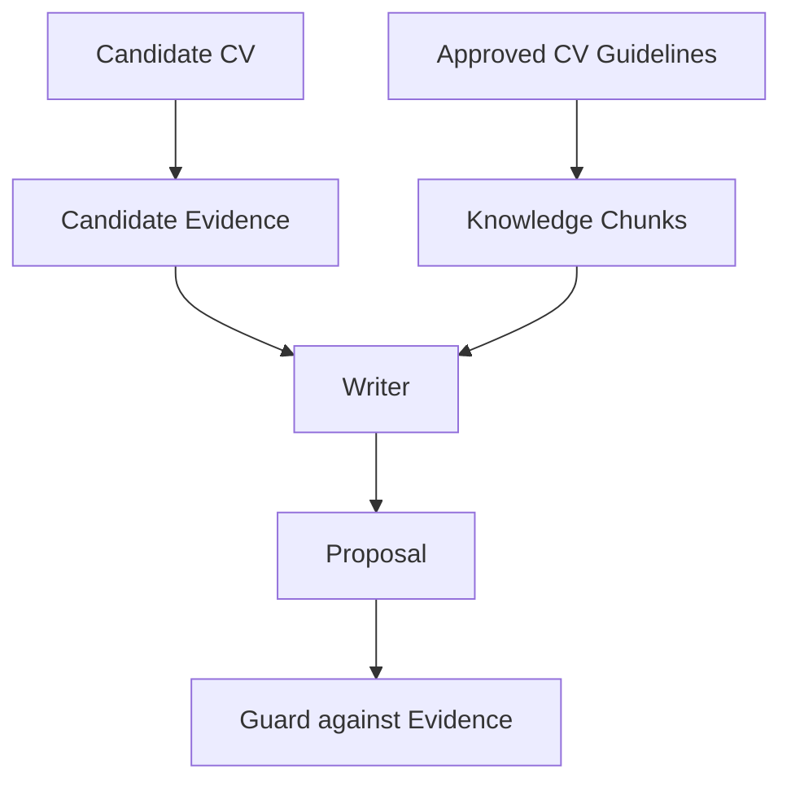
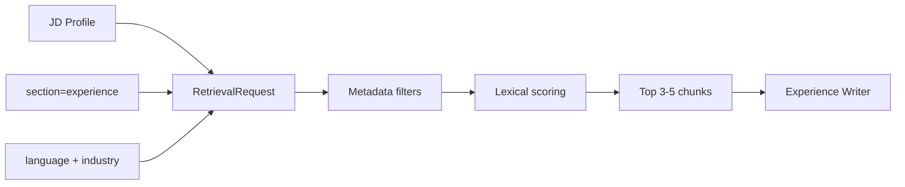

# 05 — RAG từ nền tảng đến MVP

## Bạn sẽ học được gì?

Bạn sẽ hiểu RAG giải quyết vấn đề gì, các bước retrieve, sự khác nhau giữa lexical/vector/hybrid search và vì sao Static RAG là lựa chọn đúng cho MVP hiện tại.

## RAG là gì?

**Retrieval-Augmented Generation (RAG)** là cách tìm một nhóm tài liệu liên quan rồi đưa chúng vào context của LLM trước khi sinh output.

```text
User query → Retrieve relevant chunks → Add to prompt → Generate answer
```

RAG giúp model nhận hướng dẫn cập nhật hoặc riêng của domain mà không cần fine-tune. RAG không tự bảo đảm fact đúng; chất lượng phụ thuộc corpus, metadata, retrieval và guard.

## Các thành phần

- **Document**: tài liệu nguồn.
- **Chunk**: đơn vị nhỏ được retrieve.
- **Metadata**: language, industry, section, version, status.
- **Query**: biểu diễn nhu cầu tìm kiếm.
- **Retriever**: chọn chunk liên quan.
- **Reranker**: sắp xếp lại candidates bằng mô hình/score tốt hơn.
- **Citation**: ID cho biết output đã dùng chunk nào.
- **Provenance**: nguồn gốc, version và người phê duyệt knowledge.

## Evidence không phải knowledge



Knowledge có thể nói “hãy dùng action verb”, nhưng không được khiến Writer khẳng định ứng viên biết Kubernetes nếu CV không có Kubernetes.

## Lexical, vector và hybrid search

**Lexical search** so khớp token/từ khóa. Nó dễ hiểu, rẻ và tốt khi corpus nhỏ với thuật ngữ rõ ràng.

**Embedding** biến text thành vector số. **Vector search** tìm các vector gần nhau để bắt tương đồng ngữ nghĩa dù không trùng từ. Similarity cao chỉ nói “gần về biểu diễn”, không nói tài liệu đúng hoặc an toàn.

**Hybrid search** kết hợp lexical và vector; thường thêm metadata filter và reranking.

| Cách | Ưu điểm | Hạn chế | Dùng khi |
|---|---|---|---|
| Lexical | Minh bạch, không hạ tầng mới | Kém với từ đồng nghĩa | Corpus MVP nhỏ |
| Vector | Bắt ngữ nghĩa | Tốn embedding/index, khó debug | Corpus lớn hơn |
| Hybrid | Recall và precision tốt hơn | Phức tạp nhất | Có benchmark chứng minh cần |

## Static RAG hiện tại

Interface ở [`retriever_protocol.py`](../../src/knowledge/retriever_protocol.py), hai implementation ở [`null_retriever.py`](../../src/knowledge/null_retriever.py) và [`static_retriever.py`](../../src/knowledge/static_retriever.py).



Lưu ý: pipeline hiện mặc định dùng `NullKnowledgeRetriever`; `StaticKnowledgeRetriever` đã có nhưng cần được inject/configure để thực sự hoạt động qua API.

## `top_k`, threshold và filters

- `top_k` quá nhỏ có thể bỏ sót rule; quá lớn làm prompt nhiễu.
- Threshold quá thấp đưa chunk không liên quan; quá cao dễ trả rỗng.
- Filter theo `language`, `industry`, `section`, `status=approved` phải chạy trước scoring.
- Empty retrieval là trạng thái hợp lệ: Writer vẫn phải dựa trên evidence và prompt nền.

MVP bắt đầu `top_k=3–5`, sau đó điều chỉnh bằng evaluation thay vì cảm giác.

## Khi nào mới dùng pgvector?

Chỉ thêm vector/hybrid khi:

- có khoảng 100+ chunk đã kiểm duyệt; hoặc
- lexical Recall@5 dưới ngưỡng mục tiêu (ví dụ 85%); hoặc
- query thực tế có nhiều cách diễn đạt mà token match bỏ sót.

Nếu chưa có golden queries và expected chunk IDs, đổi sang vector chỉ làm hệ thống khó đo hơn.

## Đo Recall@K

Với mỗi query đánh giá, định nghĩa tập chunk đúng. Nếu top K chứa ít nhất một chunk đúng, query được tính là hit.

```text
Recall@5 = số expected chunks tìm thấy trong top 5 / tổng expected chunks
```

Ngoài recall, cần đánh giá chunk sai có thể gây hại, latency và tỷ lệ citation được Writer thực sự dùng.

## Lỗi thường gặp

- Gọi việc đọc toàn file Markdown là production RAG.
- Chunk chứa metric mẫu không được gắn cảnh báo.
- Không filter language/section.
- Đưa CV cá nhân vào corpus dùng chung.
- Dùng similarity score như factual confidence.
- Xây vector DB trước khi có evaluation dataset.

## Bài tập thực hành

1. Viết hai chunk cùng chủ đề backend bằng `vi` và `en`, thêm metadata.
2. Tạo query DevOps; dự đoán top chunks rồi chạy retriever test.
3. Tạo năm query và expected IDs, tính Recall@3/Recall@5.
4. Chạy cùng pipeline bằng Null và Static retriever, so sánh `knowledgeChunkIds`.

```powershell
python -m pytest -q tests/test_knowledge_eval.py
```

## Checklist hoàn thành

- [ ] Tôi phân biệt candidate evidence và knowledge.
- [ ] Tôi giải thích được lexical, vector và hybrid search.
- [ ] Tôi biết similarity không phải factual confidence.
- [ ] Tôi biết điều kiện để nâng cấp pgvector.

## Câu hỏi tự kiểm tra

1. Retrieval trả chunk Kubernetes có cho phép thêm Kubernetes vào CV không?
2. Vì sao `top_k=50` thường không tốt hơn `top_k=5`?
3. Không có expected results thì tối ưu retriever dựa trên gì?

