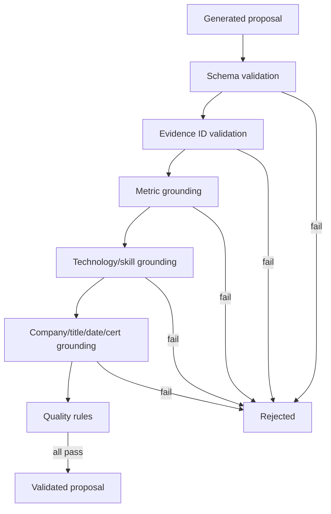

# 06 — Guardrails và evaluation

## Bạn sẽ học được gì?

Bạn sẽ biết cách phát hiện hallucination bằng code, hiểu giới hạn của guard, xây golden dataset và đo chất lượng thay vì chỉ đọc vài output đẹp.

## Khái niệm nền tảng

**Hallucination** là output nghe hợp lý nhưng không được nguồn dữ liệu hỗ trợ. Trong CV, thêm một con số, skill hoặc chức danh giả có rủi ro cao hơn một câu viết chưa hay.

**Factual consistency** yêu cầu mọi factual claim mới nhất quán với candidate evidence. **Guardrail** là cơ chế ngăn/chặn/cảnh báo output vi phạm chính sách.

Hai nhóm guard:

- **Deterministic guard**: regex, allowlist, ID lookup, schema validation. Nhanh, lặp lại được, dễ test.
- **LLM-as-judge**: dùng model đánh giá output. Linh hoạt nhưng cũng có thể sai, tốn chi phí và không nên là hàng rào duy nhất.

MVP ưu tiên deterministic guard tại [`src/guard/deterministic_guard.py`](../../src/guard/deterministic_guard.py).

## Các lớp kiểm định



Các kiểm tra hiện tại bao gồm metric, evidence ID, date, company/title, certificate, technology và banned terms. Canonical validator kiểm tra document sau khi patch.

## False positive và false negative

- **False positive của guard**: câu đúng bị reject. Ví dụ guard hiểu `Go` là động từ thay vì ngôn ngữ lập trình.
- **False negative của guard**: câu sai vẫn được accept. Ví dụ technology mới không nằm trong allowlist nên không bị nhận diện.

Không chỉ đo “bao nhiêu proposal được accept”. Cần bộ ca đúng/sai có nhãn để biết guard đang bỏ sót hay chặn quá mức.

## Evaluation dataset

**Golden dataset** là tập input và expected behavior được con người duyệt. Với CV Agent, mỗi case nên chứa:

```text
case_id
canonical_cv_fixture
job_description
language
expected_required_skills
expected_retrieval_chunk_ids
allowed_facts/evidence_ids
forbidden_claims
expected_status or invariants
```

Không cần expected bullet giống từng chữ; nên kiểm tra invariant:

- output đúng schema;
- không có forbidden fact;
- mọi metric/skill có evidence;
- patch chỉ sửa target cho phép;
- retrieval tìm đúng nhóm rule.

## Các chỉ số cần đo

| Chỉ số | Câu hỏi |
|---|---|
| Schema validity | Output có parse và validate được không? |
| Evidence coverage | Bao nhiêu proposal có evidence hợp lệ? |
| Hallucination rate | Bao nhiêu proposal chứa fact không hỗ trợ? |
| Guard precision | Trong proposal bị reject, bao nhiêu thật sự sai? |
| Guard recall | Trong proposal sai, guard bắt được bao nhiêu? |
| Retrieval Recall@K | Top K tìm được bao nhiêu expected chunks? |
| Latency P50/P95 | Đa số và trường hợp chậm mất bao lâu? |
| Apply conflict rate | Bao nhiêu apply bị stale version/hash? |

## Ngưỡng MVP

- 100% response hợp lệ theo schema.
- 0 company/title/date giả trong golden set.
- 0 metric mới thiếu evidence.
- Ít nhất 90% proposal có evidence citation hợp lệ.
- Preview không mutation CV.
- Apply luôn kiểm tra version và hash.
- Lexical Recall@5 mục tiêu từ 85% trở lên trước khi cân nhắc vector RAG.

## Offline và production evaluation

**Offline evaluation** chạy trên fixture/golden set trước release, ổn định và không dùng dữ liệu người dùng. **Production monitoring** theo dõi aggregate metrics: latency, error, rejection, conflict và tỷ lệ user accept. Không log raw CV/JD.

User accept rate thấp không tự động chứng minh model kém: có thể UI khó dùng, JD không phù hợp hoặc guard quá chặt. Cần phân tích theo reason code.

## Regression test

Regression test bảo đảm lỗi đã sửa không quay lại. Mỗi bug production nên tạo một fixture tối giản và test tái hiện trước khi sửa.

Ví dụ cần có:

- bullet gốc không có số, proposal thêm `70%` → reject;
- JD có Kubernetes, CV không có → proposal thêm Kubernetes phải reject;
- company/date/title thay đổi → reject;
- `beforeHash` sai → không apply;
- patch hợp lệ → chỉ đúng bullet thay đổi.

## Lỗi thường gặp

- Dùng keyword overlap làm thước đo duy nhất.
- Golden dataset chứa output do chính model tự chấm.
- Không lưu reason code khi reject.
- Chỉ test happy path.
- Log toàn bộ CV để debug production.
- Đổi prompt/model nhưng không chạy regression.

## Bài tập thực hành

1. Thêm case metric giả và case skill chỉ có trong JD.
2. Với 10 proposal có nhãn, tự tính precision/recall của guard.
3. Giải thích vì sao câu đầy keyword nhưng thiếu evidence vẫn là CV xấu.

```powershell
python -m pytest -q tests/test_writer_and_guards.py tests/test_canonical_validator.py tests/test_patch_applier.py
```

## Checklist hoàn thành

- [ ] Tôi phân biệt deterministic guard và LLM-as-judge.
- [ ] Tôi hiểu false positive/false negative.
- [ ] Tôi thiết kế golden case bằng invariant.
- [ ] Tôi biết metric nào cần theo dõi mà không log PII.

## Câu hỏi tự kiểm tra

1. Guard accept 100% proposal có chắc là tốt không?
2. Vì sao expected output không nên luôn là một câu cố định?
3. Khi đổi model Gemini, test nào phải chạy lại?

