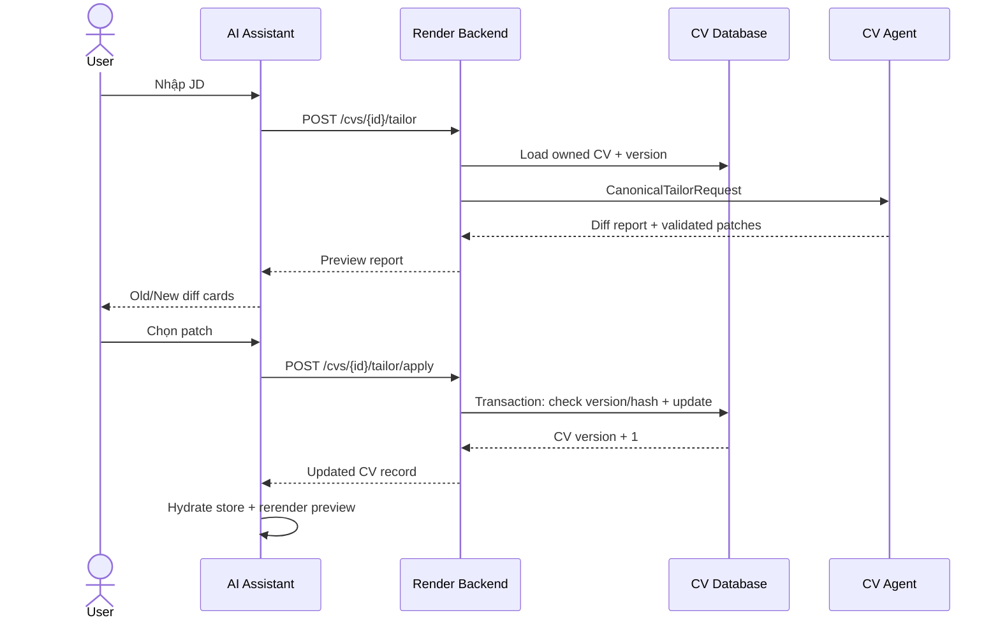

# 07 — Tích hợp với Render

## Bạn sẽ học được gì?

Bạn sẽ hiểu preview/review/apply end-to-end, HTTP error semantics, atomic update và cách đặt luồng tailor vào AI Assistant mà không để browser gọi Agent trực tiếp.

## Trạng thái code hiện tại

Render Backend đã có:

- `POST /v1/cvs/:id/tailor` để lấy proposal mà không sửa CV;
- `POST /v1/cvs/:id/tailor/apply` để apply patch với version/hash check.

Xem [`cv.controller.ts`](../../../Render/MODULE_BE/src/cv/cv.controller.ts), [`cv.service.ts`](../../../Render/MODULE_BE/src/cv/cv.service.ts) và test [`cv-tailor.test.cjs`](../../../Render/MODULE_BE/test/cv-tailor.test.cjs).

Frontend có [`AiAssistant.tsx`](../../../Render/MODULE_FE/src/features/assistant/AiAssistant.tsx) nhưng chưa có review flow và `cv.service.ts` chưa expose tailor/apply methods. Đây là phần tích hợp chính còn thiếu.

## Luồng end-to-end



## Preview không được mutation

Endpoint tailor phải:

1. xác thực user;
2. kiểm tra ownership;
3. parse và validate CV;
4. gọi Agent bằng service key;
5. validate Agent response;
6. trả proposal.

Nó không được cập nhật `yamlContent`, `version` hoặc thumbnail. `appliedDocument` từ Agent chỉ là preview copy, không phải dữ liệu đã lưu.

## Apply phải atomic

Trong một transaction logic:

1. kiểm tra CV không locked;
2. kiểm tra `baseVersion`;
3. từ chối duplicate target;
4. kiểm tra section/entry/type/field/index;
5. kiểm tra locked path;
6. tính lại `beforeHash`;
7. apply tất cả patch lên copy;
8. validate canonical document;
9. update với điều kiện version cũ và tăng version đúng một lần.

Bất kỳ bước nào lỗi thì không lưu patch nào.

## HTTP status và UX

| Status | Ý nghĩa | UI nên làm gì |
|---|---|---|
| `401/403` | Chưa đăng nhập/không có quyền | Yêu cầu đăng nhập hoặc báo access denied |
| `409` | Version/hash conflict | Không retry tự động; reload và tạo proposal mới |
| `422` | JD/CV/patch không hợp lệ hoặc CV locked | Hiển thị lỗi có thể sửa |
| `502` | Agent trả response không hợp lệ | Báo AI service response error |
| `503` | Agent/Gemini unavailable/timeout | Cho phép thử lại preview |

Retry preview có thể an toàn vì không mutation. Retry apply chỉ an toàn khi có idempotency/OCC rõ ràng.

## State cho AI Assistant

```text
idle
→ submitting
→ review {baseVersion, proposals, selectedPatchKeys}
→ applying
→ success

submitting/applying → error
applying → conflict
```

Mỗi diff card hiển thị:

- company/position làm context;
- bullet cũ;
- bullet đề xuất;
- rationale và guard warnings;
- checkbox chỉ bật cho proposal `validated`.

`rejected` và `unchanged` có thể hiển thị để giải thích nhưng không được gửi tới apply.

## Security boundary

- Browser gửi session/JWT chỉ tới Render Backend.
- `AI_SECRET_KEY` chỉ tồn tại ở Backend và Agent runtime.
- Backend không trả service key về client.
- Agent không tin `cvId` là bằng chứng ownership; Backend đã xác thực ownership trước khi gọi.
- Giới hạn độ dài JD và request body; không log body.

## Lỗi thường gặp

- Frontend gọi thẳng `AI_API_URL` trong production tailor flow.
- Apply `appliedDocument` do Agent trả thay vì áp semantic patches phía Backend.
- Gửi mọi proposal, kể cả rejected, tới apply.
- Khi `409`, tự thay version rồi retry.
- Store frontend vẫn giữ revision cũ sau success.
- Dùng cùng secret cho user auth và service auth.

## Bài tập thực hành

1. Vẽ sequence cho trường hợp Gemini timeout.
2. Mở hai tab ở version 5; cho Tab A apply rồi dự đoán response Tab B.
3. Thiết kế một diff card cho `validated`, `rejected`, `unchanged`.
4. Liệt kê dữ liệu nào được phép log tại mỗi service.

## Checklist hoàn thành

- [ ] Tôi biết preview không được ghi database.
- [ ] Tôi biết apply cần atomicity, OCC và hash.
- [ ] Tôi map được HTTP status sang UX.
- [ ] Tôi biết vì sao tailor flow phải qua Backend.

## Câu hỏi tự kiểm tra

1. Agent đã validate patch, Backend có cần validate lại không?
2. Vì sao `409` không nên retry tự động?
3. Sau apply thành công, frontend phải cập nhật những state nào?

