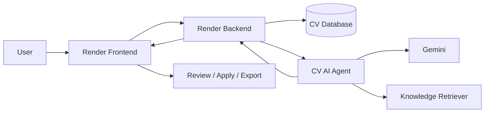

# CV AI Agent Learning Path

Tài liệu này dành cho người đã biết Python/TypeScript cơ bản nhưng mới bắt đầu với LLM, Agent và RAG. Mục tiêu không phải chỉ chạy được code, mà là hiểu dữ liệu đi qua hệ thống thế nào, bước nào có thể sai và cách chứng minh hệ thống đủ an toàn để sửa CV.

> Delivery backlog nằm ở [IMPLEMENTATION_PLAN](../IMPLEMENTATION_PLAN.md). Bộ tài liệu này giải thích kiến thức và cách thực hành, không thay thế backlog.

## Bạn sẽ xây gì?

Hệ thống nhận CV canonical và Job Description (JD), phân tích yêu cầu tuyển dụng, dùng dữ liệu thật trong CV làm **evidence**, dùng knowledge base làm hướng dẫn viết, tạo đề xuất thay đổi rồi chờ người dùng duyệt.

Nguyên tắc trung tâm:

- Render sở hữu user, CV, version và quyền ghi dữ liệu.
- Agent không lưu CV; Agent chỉ trả đề xuất có bằng chứng.
- Knowledge nói **cách viết tốt**, candidate evidence nói **điều gì là sự thật**.
- Proposal qua guard mới là `validated`; chỉ người dùng mới có quyền `userAccepted`.

## Thứ tự học

| Thứ tự | Chương | Kết quả cần đạt |
|---|---|---|
| 1 | [Kiến trúc hệ thống](01-system-architecture.md) | Biết trách nhiệm của FE, BE, Agent và database |
| 2 | [Agent workflow](02-agent-workflow.md) | Theo dấu được một bullet qua pipeline |
| 3 | [Contract, evidence và patch](03-contract-evidence-patch.md) | Hiểu vì sao dùng stable ID, hash và OCC |
| 4 | [LLM provider và prompting](04-llm-provider-and-prompting.md) | Gọi model bằng structured output an toàn |
| 5 | [RAG nền tảng](05-rag-fundamentals.md) | Phân biệt Static RAG, vector RAG và evidence |
| 6 | [Guardrail và evaluation](06-guardrails-and-evaluation.md) | Viết test chống bịa và đo retrieval |
| 7 | [Tích hợp Render](07-render-integration.md) | Hiểu preview → review → atomic apply |
| 8 | [Implementation workbook](08-implementation-workbook.md) | Thực hiện project theo checkpoint |
| Tra cứu | [Glossary](glossary.md) | Tra nhanh thuật ngữ |

## Bản đồ task và kiến thức

| Task | Đọc trước | Thực hành chính |
|---|---|---|
| Làm test chạy ổn định | Chương 2, 6 | Mock provider, async test, regression |
| Chuẩn hóa canonical contract | Chương 3 | JSON Schema, Pydantic, Zod |
| Bật Static RAG | Chương 5 | metadata filter, lexical score, Recall@5 |
| Chống hallucination | Chương 3, 6 | evidence grounding, deterministic guard |
| Tích hợp Render Backend | Chương 1, 7 | auth, error mapping, OCC |
| Xây review UI | Chương 3, 7 | diff state, user acceptance, conflict UX |

## Cách học mỗi chương

1. Đọc mục khái niệm, không cần thuộc định nghĩa.
2. Mở file code được liên kết và tìm input/output của module.
3. Tự làm bài tập trước khi xem test có sẵn.
4. Chạy test liên quan bằng PowerShell.
5. Đánh dấu checklist chỉ khi bạn giải thích lại được bằng lời của mình.

## Checklist tiến độ

- [ ] Tôi vẽ được luồng request end-to-end.
- [ ] Tôi phân biệt deterministic và probabilistic step.
- [ ] Tôi giải thích được candidate evidence khác knowledge chunk.
- [ ] Tôi giải thích được `baseVersion` và `beforeHash` bảo vệ điều gì.
- [ ] Tôi viết được mock LLM response có schema.
- [ ] Tôi giải thích được vì sao MVP dùng lexical retrieval.
- [ ] Tôi tạo được test phát hiện metric hoặc skill bị bịa.
- [ ] Tôi mô phỏng được conflict giữa hai tab.
- [ ] Tôi hoàn thành các checkpoint trong workbook.

## Quy tắc bảo mật khi học

- Không đặt API key trong code, commit, ảnh chụp hoặc tài liệu.
- Nếu key từng xuất hiện trong chat/log, hãy thu hồi và tạo key mới.
- Dùng `.env` cục bộ hoặc secret manager; chỉ commit `.env.example`.
- Không đưa CV thật hoặc thông tin cá nhân vào fixture công khai.

